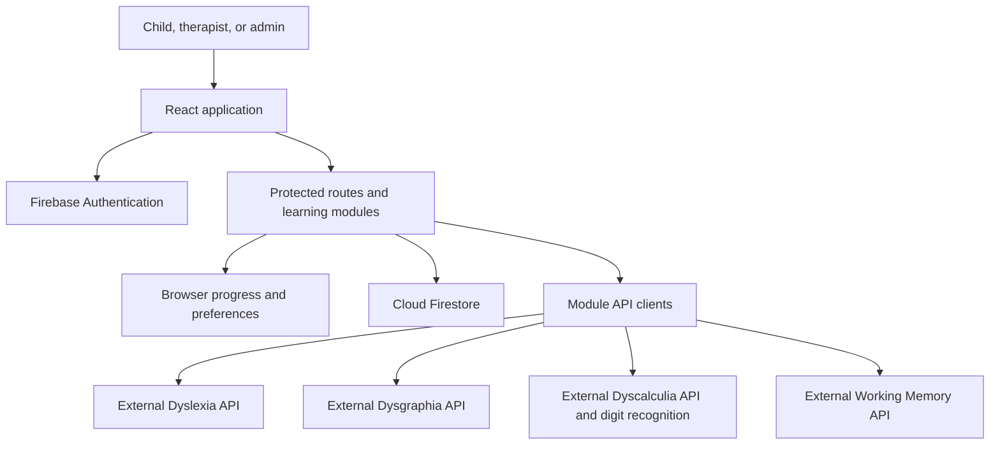

# Smart Learn

**Sinhala-first learning through play.**

Smart Learn is an interactive learning application for children who need support with reading, writing, numeracy, and working memory. It combines themed activities, spoken instructions, progressive challenges, star rewards, and progress dashboards in a React application.

This repository contains the **frontend, Firebase configuration, and integration clients**. Module APIs and handwriting recognition services run separately; their backend source code is not included in this checkout.

## Contents

- [Learning modules](#learning-modules)
- [Platform features](#platform-features)
- [Technology](#technology)
- [Architecture and data flow](#architecture-and-data-flow)
- [Repository structure](#repository-structure)
- [Getting started](#getting-started)
- [Environment configuration](#environment-configuration)
- [Routes and access](#routes-and-access)
- [Development and verification](#development-and-verification)
- [Deployment](#deployment)
- [Troubleshooting](#troubleshooting)
- [Code navigation and contribution](#code-navigation-and-contribution)
- [Project documentation](#project-documentation)

## Learning modules

| Module | Learning activities | Progress dashboard |
| --- | --- | --- |
| **Dyslexia** | Reading placement assessment, letter pronunciation and listening, sound matching, word and image matching, word building, and rhyme activities | `/dyslexia-dashboard` |
| **Dysgraphia** | Shape tracing, Sinhala letter practice, mirror-letter challenges, word tracing, and writing along lines | `/dysgraphia/progress` |
| **Dyscalculia** | Number tracing from 0–9, number listening, number ordering, balloon counting, symbol recognition, and number/image matching | `/dyscalculia/dashboard` |
| **Working memory** | Sequence recall, N-back, color memory, shape recall, picture puzzles, odd-one-out activities, and video-story recall | `/working-memory/dashboard` |

Open `/modules` to choose an activity area, or `/dashboards` to choose a progress dashboard.

## Platform features

- **Sinhala learning experience:** Sinhala activity labels, recorded instructions, and visual prompts.
- **Themed activity screens:** illustrated jungle, dinosaur, and ocean settings with large interactive controls.
- **Progress and rewards:** stars, completed levels, performance summaries, and module-specific progress tracking.
- **Account access:** Firebase email/password and Google sign-in, persistent sessions, and user profiles.
- **Role-aware navigation:** student, therapist, and admin access through protected routes.
- **Recommendations interface:** an admin/therapist screen for learner recommendations and admin role management, subject to deployed Firestore permissions.
- **Responsive navigation:** module cards, dashboard cards, floating menus, and back controls for desktop and smaller screens.
- **Diagnostics:** a global error boundary, telemetry helpers, and optional Sentry reporting.

## Technology

Versions below describe the dependency families declared in the frontend package manifest.

| Area | Tools |
| --- | --- |
| Application | React 18, JavaScript ES modules, Vite 5 |
| Navigation | React Router 6 with lazy-loaded pages |
| Styling and motion | Tailwind CSS 4, module CSS, Framer Motion, Lucide icons |
| Interactive activities | DnD Kit, React Sketch Canvas, Canvas Confetti |
| Identity and profiles | Firebase Authentication and Cloud Firestore |
| API integration | Axios and module-specific API/service layers |
| Verification | Vitest, jsdom, React Testing Library, ESLint |
| Hosting configuration | Vercel and Firebase Hosting |

See [package.json](smart-learn-frontend/package.json) for scripts and declared dependencies, and [package-lock.json](smart-learn-frontend/package-lock.json) for resolved versions.

## Architecture and data flow



The application mounts authentication and routing in [main.jsx](smart-learn-frontend/src/main.jsx). [AppRouter.jsx](smart-learn-frontend/src/routes/AppRouter.jsx) selects pages and applies access guards. Module components handle activities, while API clients and services communicate with external systems.

Progress storage depends on the module:

| Data | Storage and integration |
| --- | --- |
| Accounts and sign-in | Firebase Authentication |
| Profiles, recommendations, login events, and admin audit records | Cloud Firestore, subject to security rules |
| Dyscalculia stars and learning progress | Learner-scoped browser storage with Firestore synchronization at `userProfiles/{uid}/progress/dyscalculia` |
| Working memory progress | Module progress context, browser persistence, and Working Memory API calls |
| Reading and handwriting results | Module API/service integrations and module-specific state |
| Audio preferences and session flags | Browser storage and in-memory state |

Browser persistence supports individual learning flows; it does not mean every feature works offline. Sign-in, server evaluation, and cloud synchronization need their respective services.

## Repository structure

```text
R26-IT-114/
├── README.md
├── DATABASE_AND_DATA_FLOW.md
├── LIVE_DATABASE_DATA.md
├── report-source.md
└── smart-learn-frontend/
    ├── src/
    │   ├── main.jsx                  # Application providers and entry point
    │   ├── App.jsx                   # Shared navigation and routed content
    │   ├── pages/                    # Landing, authentication, selection, admin
    │   ├── routes/                   # Route definitions and access guards
    │   ├── modules/
    │   │   ├── dyslexia/
    │   │   ├── dysgraphia/
    │   │   ├── dyscalculia/
    │   │   └── working-memory/
    │   ├── components/               # Common and shared UI
    │   ├── context/                  # Authentication and application state
    │   ├── hooks/                    # Shared React hooks
    │   ├── services/                 # Firebase, API configuration, telemetry
    │   ├── styles/                   # Global and shared styles
    │   ├── assets/                   # Illustrations, audio, and other media
    │   ├── utils/                    # Shared helpers
    │   └── test/                     # Test setup
    ├── .env.example
    ├── package.json
    ├── package-lock.json
    ├── vite.config.js
    ├── vercel.json
    ├── firebase.json
    ├── firestore.rules
    ├── FIREBASE_SETUP.md
    └── RELEASE_CHECKLIST.md
```

Run npm commands inside `smart-learn-frontend/`. The repository root has no application `package.json`.

## Getting started

### 1. Prepare dependencies

Use Node.js **20 or newer**, npm, and a browser. To use authentication and cloud progress, configure a Firebase project. To use server-backed activities, provide the corresponding module APIs.

From the repository root:

```bash
cd smart-learn-frontend
npm ci
cp .env.example .env
```

On Windows, copy `.env.example` to `.env` using your editor or file manager.

### 2. Configure services

Edit `smart-learn-frontend/.env` using the [configuration reference](#environment-configuration). The example file mixes local Dyscalculia services with a hosted Working Memory service; replace values to match your environment.

For your Firebase project:

1. Enable Email/Password and Google providers in Firebase Authentication.
2. Create a Firestore database.
3. Add `localhost` and your deployed frontend domain to Authentication's authorized domains.
4. Set the Firebase web configuration variables listed below.
5. Review and deploy the repository's Firestore rules to the intended project.

The source includes fallback Firebase project values. Set explicit variables when connecting to your own project. See [FIREBASE_SETUP.md](smart-learn-frontend/FIREBASE_SETUP.md) for provider configuration and first-admin setup.

### 3. Start development

```bash
npm run dev
```

Open **https://localhost:5173**. Vite uses a development HTTPS certificate, so your browser may ask you to accept it. Port `5173` is fixed with `strictPort: true`; stop another server using that port before starting a second instance.

Register or sign in, then open `/modules`.

## Environment configuration

Vite reads frontend environment variables at startup and build time. Restart the development server after editing `.env`; rebuild a deployed frontend after changing its environment variables.

### Module API URLs

| Variable | Expected value |
| --- | --- |
| `VITE_DYSCALCULIA_API_URL` | General Dyscalculia API base; also the digit-recognition fallback when no ML URL is configured |
| `VITE_DYSCALCULIA_ML_URL` | Digit-recognition backend origin; takes precedence over the Dyscalculia API URL for prediction |
| `VITE_DYSGRAPHIA_API_URL` | Backend origin; its client appends `/api/dysgraphia/...` |
| `VITE_DYSLEXIA_API_URL` | API base including any required backend prefix, such as `https://your-reading-host.example/api/dyslexia`; its client appends `/overview`, `/sessions`, etc. |
| `VITE_WORKINGMEMORY_API_URL` | Preferred Working Memory URL: an origin or full `/api/working-memory` base |
| `VITE_WORKING_MEMORY_API_URL` | Supported Working Memory alias; used if the preferred variable is absent |
| `VITE_API_URL` | Shared fallback for modules without an explicit API URL; module path conventions still apply |

Working Memory adds `/api/working-memory` when configured with an origin. Other modules have different prefix conventions; do not assume the same URL format works for every client.

For hosted services, configure HTTPS URLs. For Dyscalculia prediction, the client appends `/api/dyscalculia/tracing/predict`. Remove or replace an old `VITE_DYSCALCULIA_ML_URL` when switching recognition hosts, because it overrides `VITE_DYSCALCULIA_API_URL`.

### Local API configuration

For separately running services that match the development proxy paths:

```env
VITE_DYSCALCULIA_API_URL=/api/dyscalculia
VITE_DYSCALCULIA_ML_URL=http://localhost:4002
VITE_DYSGRAPHIA_API_URL=/
VITE_DYSLEXIA_API_URL=/api/dyslexia
VITE_WORKINGMEMORY_API_URL=/api/working-memory
```

The Dysgraphia value `/` is intentional: its client already appends the complete `/api/dysgraphia` prefix. If that variable is omitted, the shared fallback can duplicate the prefix for this client.

The proxy targets in [vite.config.js](smart-learn-frontend/vite.config.js) are:

| Request from the frontend | Local target | Path handling |
| --- | --- | --- |
| `/ml-api/*` | `http://localhost:4002` | Removes `/ml-api` |
| `/api/working-memory/*` | `http://localhost:4000` | Preserves the path |
| `/api/workingMemory/*` | `http://localhost:4000` | Rewrites to `/api/working-memory/*` |
| `/api/dysgraphia/*` | `http://localhost:5000` | Preserves the path |
| `/api/dyslexia/*` | `http://localhost:5001` | Preserves the path |
| Other `/api/*` and `/health` requests | `http://localhost:5001` | Preserves the path |

There is no dedicated general Dyscalculia API proxy. In the local example, `/api/dyscalculia` also reaches port `5001` through the generic `/api` mapping. That service must implement the Dyscalculia endpoints, or you must add a dedicated proxy target for your separate Dyscalculia API. Digit recognition has its own mapping to port `4002`.

During development, a non-HTTPS digit-recognition URL uses `/ml-api`; its proxy target remains port `4002`. A configured HTTPS recognition URL is called directly. These mappings configure routing only; they do not start backend processes.

### Firebase and diagnostics

Copy the web app configuration from your Firebase project into `.env`:

```env
VITE_FIREBASE_API_KEY=your-firebase-web-api-key
VITE_FIREBASE_AUTH_DOMAIN=your-project.firebaseapp.com
VITE_FIREBASE_PROJECT_ID=your-project-id
VITE_FIREBASE_STORAGE_BUCKET=your-project-storage-bucket
VITE_FIREBASE_MESSAGING_SENDER_ID=your-messaging-sender-id
VITE_FIREBASE_APP_ID=your-firebase-app-id

# Optional analytics and error reporting
VITE_FIREBASE_MEASUREMENT_ID=your-measurement-id
VITE_SENTRY_DSN=
```

`VITE_*` values become part of the browser application. Keep server credentials and service-account private keys in the backend environment. Local `.env` files are ignored by Git.

Sentry initializes when `VITE_SENTRY_DSN` is set. Otherwise, telemetry helpers still report errors to the browser console.

## Routes and access

| Route | Access | Purpose |
| --- | --- | --- |
| `/` | Public | Landing page |
| `/login`, `/register` | Public | Authentication |
| `/modules` | Student, therapist, admin | Learning module selection |
| `/dashboards` | Student, therapist, admin | Progress dashboard selection |
| `/dyslexia/*` | Authenticated module routes | Reading activities |
| `/dysgraphia/*` | Authenticated module routes | Writing activities |
| `/dyscalculia/*` | Student, therapist, admin | Numeracy activities |
| `/working-memory/*` | Student, therapist, admin | Memory activities |
| `/dyslexia-dashboard` | Student, therapist, admin | Reading progress |
| `/admin/recommendations` | Therapist, admin | Recommendations interface; admin role-management controls |
| `/404` | Public | Unknown-route destination |

Nested module routes are defined in each module's `routes.jsx`. The six primary Dyscalculia activity routes are:

```text
/dyscalculia/number-tracing
/dyscalculia/listening-game
/dyscalculia/number-sorting
/dyscalculia/balloon-pop
/dyscalculia/symbol-detective
/dyscalculia/number-matching
```

Frontend route access and Firestore permissions are separate. The checked-in rules allow users to read their own profiles; the admin interface's cross-user listing needs a compatible authorized data-access design. See the troubleshooting section before assuming all admin data operations are enabled.

## Development and verification

All commands below run from `smart-learn-frontend/`.

| Command | Purpose |
| --- | --- |
| `npm run dev` / `npm start` | Start the Vite development server |
| `npm run build` | Generate the production application in `dist/` |
| `npm run preview` | Serve the generated build locally |
| `npm run lint` | Run project ESLint checks |
| `npm test` | Run Vitest once |
| `npm run test:watch` | Run Vitest in watch mode |
| `npm run firebase:deploy:rules` | Deploy rules using the configured Firebase project |
| `npm run firebase:deploy:rules:project -- your-project-id` | Deploy rules to an explicitly selected project |

Run the standard verification commands before submitting a change:

```bash
npm run lint
npm test
npm run build
```

For a focused test run:

```bash
npx vitest run src/modules/dyscalculia/utils/dyscalculiaProgress.test.js
```

Tests use jsdom and the matchers configured in [setupTests.js](smart-learn-frontend/src/test/setupTests.js). Some newer Node runtimes expose a native `localStorage` that conflicts with this test environment. If tests fail with `localStorage` being unavailable, use Node 20 or, on a runtime supporting the flag:

```bash
NODE_OPTIONS=--no-experimental-webstorage npm test
```

On PowerShell, set `$env:NODE_OPTIONS="--no-experimental-webstorage"` before running `npm test`.

Browser checks should cover signing in, opening each module, completing an activity, checking saved progress, using audio and back controls, and opening a dashboard on desktop and mobile. A successful production build does not verify external API availability or deployed Firebase permissions.

## Deployment

### Vercel

Configure the frontend project as follows:

| Setting | Value |
| --- | --- |
| Root directory | `smart-learn-frontend` |
| Framework | Vite |
| Install command | `npm ci` |
| Build command | `npm run build` |
| Output directory | `dist` |

Add the Firebase configuration and each module's HTTPS API URL to the intended deployment environment, then rebuild. Add the deployed frontend domain to Firebase Authentication and to the external APIs' allowed origins.

[vercel.json](smart-learn-frontend/vercel.json) provides the single-page application fallback for frontend routes. API, ML, health, asset, and file paths are excluded from that fallback. It does **not** proxy backend services; Vite's development proxies are not part of the production build.

### Firebase Hosting

[firebase.json](smart-learn-frontend/firebase.json) serves `dist/` and rewrites frontend routes to `index.html`. Check `.firebaserc` and the `hosting.site` setting before deploying, since they reference an existing project and hosting site.

After selecting your intended project and hosting site:

```bash
npm run build
npx firebase-tools deploy --only hosting --project your-project-id
```

Deploy Firestore rules separately when required:

```bash
npm run firebase:deploy:rules:project -- your-project-id
```

Use the [release checklist](smart-learn-frontend/RELEASE_CHECKLIST.md) for account-role checks, staging verification, and deployment readiness.

## Troubleshooting

| Symptom | What to check |
| --- | --- |
| npm cannot find `package.json` | Run commands inside `smart-learn-frontend/`, not the repository root. |
| Port `5173` is already in use | Stop the existing development server; Vite does not automatically choose another port. |
| Local browser certificate warning | Development uses HTTPS through `@vitejs/plugin-basic-ssl`; accept the local development certificate. |
| Google sign-in fails | Verify the Google provider, Firebase web configuration, authorized domain, and browser popup permissions. |
| A module returns 404 or a duplicated API path | Check the module's URL convention. Dysgraphia appends its full prefix; Dyslexia appends relative endpoint names. Inspect the final request URL in browser DevTools. |
| Digit recognition uses the wrong service | Check `VITE_DYSCALCULIA_ML_URL` first, then `VITE_DYSCALCULIA_API_URL`; local development recognition uses the proxy on port `4002`. |
| Working Memory calls the wrong host | Check both environment-variable spellings; `VITE_WORKINGMEMORY_API_URL` has priority over `VITE_WORKING_MEMORY_API_URL`. |
| CORS or mixed-content errors | Check the frontend origin allowed by the API and use HTTPS for hosted services. Use the configured development proxy for local HTTP services. |
| Admin user listing returns permission denied | The checked-in Firestore rules allow owner-only profile reads, while the admin screen queries across profiles. Review the intended permissions or provide an authorized backend listing API. |
| Stars or progress do not synchronize | Check the signed-in learner, browser storage, Firestore rules, API connectivity, and module-specific storage behavior. |
| `.env` changes have no effect | Restart Vite locally; rebuild and redeploy for production. |
| Direct links fail after deployment | Verify the host's SPA rewrite and that API requests are routed to actual services. |
| Build warns about large chunks | Review lazy-loading boundaries and large dependencies/assets when investigating loading performance. |

## Code navigation and contribution

| What you want to change | Start here |
| --- | --- |
| Application providers and startup | [main.jsx](smart-learn-frontend/src/main.jsx) |
| Global menu and dashboard back button | [Navbar.jsx](smart-learn-frontend/src/components/common/Navbar.jsx) |
| Route definitions and access | [AppRouter.jsx](smart-learn-frontend/src/routes/AppRouter.jsx), [ProtectedRoute.jsx](smart-learn-frontend/src/routes/ProtectedRoute.jsx) |
| Module selection cards | [ModuleSelection.jsx](smart-learn-frontend/src/pages/ModuleSelection.jsx) |
| Dashboard selection cards | [DashboardSelection.jsx](smart-learn-frontend/src/pages/DashboardSelection.jsx) |
| Shared selection-page styles | [ModuleSelection.css](smart-learn-frontend/src/pages/ModuleSelection.css) |
| Dyscalculia activity menu | [DyscalculiaHome.jsx](smart-learn-frontend/src/modules/dyscalculia/pages/DyscalculiaHome.jsx), [dyscalculia-home.css](smart-learn-frontend/src/modules/dyscalculia/styles/dyscalculia-home.css) |
| Module API URL selection | [apiConfig.js](smart-learn-frontend/src/services/apiConfig.js), [axiosInstance.js](smart-learn-frontend/src/services/axiosInstance.js) |
| Firebase setup and permissions | [firebaseConfig.js](smart-learn-frontend/src/services/firebaseConfig.js), [firestore.rules](smart-learn-frontend/firestore.rules) |

When extending a module:

1. Add the activity under that module's `pages/` or `components/` directory.
2. Register its route in the module's `routes.jsx` and connect the module selection flow.
3. Keep API calls in the module's API/service layer and use its existing progress identifiers and storage conventions.
4. Scope styles to the module or page so visiting another activity does not replace its theme.
5. Preserve Sinhala labels, readable text, touch targets, keyboard navigation, and relevant audio controls.
6. Add tests for changed behavior, run the relevant checks, and document any new configuration.

Use the section comments in selection pages and Dyscalculia styles to find headings, cards, progress controls, and responsive rules quickly.

## Project documentation

| Document | Purpose |
| --- | --- |
| [Firebase setup](smart-learn-frontend/FIREBASE_SETUP.md) | Authentication providers, initial admin setup, rules, and diagnostics |
| [Release checklist](smart-learn-frontend/RELEASE_CHECKLIST.md) | Functional, quality, and deployment verification |
| [Database and data flow](DATABASE_AND_DATA_FLOW.md) | Earlier Working Memory architecture and data-schema notes |
| [Database sample data](LIVE_DATABASE_DATA.md) | Recorded test-data examples, rather than a live database view |
| [Working Memory implementation guide](smart-learn-frontend/src/modules/working-memory/README.md) | Earlier module design and component usage notes |

Some supporting documents describe earlier implementation stages. Check the current source, route definitions, and API clients when an older game list or endpoint example differs.
